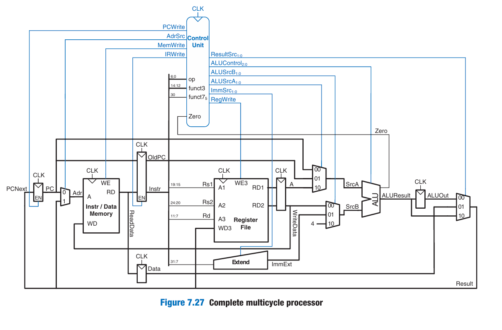

# RISC-V Processor
This work is based on the RISC-V processor architectures described in Chapter 7 of 'Digital Design and Computer Architecture' (Harris/Harris).

It begins with a single-cycle design, then evolves into a multicycle architecture, before being pipelined to create a more optimal design.

The architecture of the single-cycle processor can be seen here:

The single-cycle processor has three major weaknesses:
1. It requires separate memory units for instructions and data, while most processors have a single external memory for both.
2. It requires a clock cycle long enough to support the slowest instruction (typically lw) even though most instructions could be performed faster.
3. It requires three adders: one in the ALU, and two for the PC logic. These are quite expensive, especially if they must be fast.

The multi-cycle processor addresses such weaknesses by breaking instructions into multiple  shorter steps. The memory, ALU, and register file have the longest delays, so to keep the delay for each short step equal, this processor uses just one of these units per step.

The architecture of the multi-cycle processor can be seen here:

