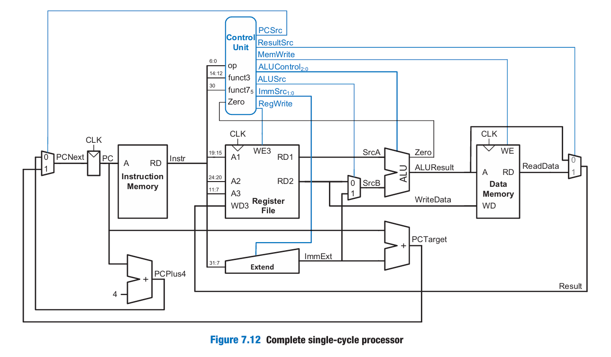

# RISC-V Processor
This work is based on the RISC-V processor architectures described in Chapter 7 of 'Digital Design and Computer Architecture' (Harris/Harris).

It begins with a single-cycle design, then evolves into a multicycle architecture, before being pipelined to create a more optimal design.

The architecture of the single-cycle processor can be seen here:

